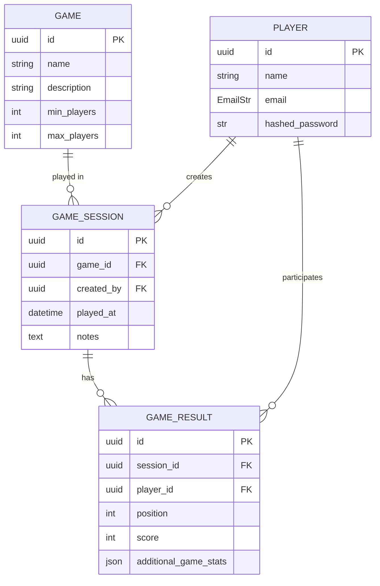

# Database

For now SQLite is the only supported database and the tables are created with `SQLModel.metadata.create_all` (no migrations yet).

A game must have `min_players` and `max_players` greater than 0, and `min_players` must not exceed `max_players` (the API answers `422` otherwise).
